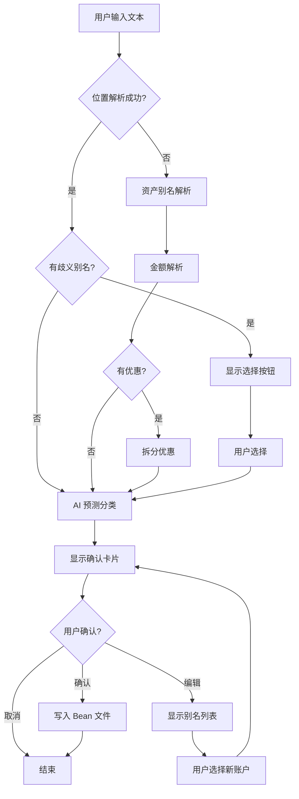

# TG_bot - Telegram Beancount 记账机器人

> 一个基于 Telegram 的智能记账机器人，通过自然语言输入快速记录 Beancount 格式的交易。

## 项目概述

### 核心功能
- **自然语言记账**：支持中英文混合输入，如 `晚饭 稻禾风 32.55 citic`
- **智能账户匹配**：结合本地别名规则和 Gemini AI 进行账户预测
- **多币种支持**：支持 `@@` 语法的货币转换交易
- **优惠/折扣处理**：自动识别并拆分优惠金额
- **歧义处理**：当别名对应多个账户时，提供交互式选择

### 技术栈
- **语言**：Python 3.11+
- **框架**：python-telegram-bot
- **记账格式**：Beancount
- **AI 服务**：Google Gemini API
- **部署**：Systemd (Linux/Armbian)

---

## 架构设计

```
TG_bot/
├── main.py                 # 入口文件，Telegram Bot 处理逻辑
├── config/
│   ├── .env                # 环境变量 (API Keys)
│   └── settings.yaml       # 用户配置和别名
├── data/
│   ├── main.bean           # Beancount 主文件
│   ├── 2026.bean           # 当前年度交易记录
│   └── accounts/           # 账户定义文件
│       ├── assets.bean     # 资产账户
│       ├── expenses.bean   # 支出账户
│       ├── income.bean     # 收入账户
│       └── liabilities.bean # 负债账户
└── src/
    ├── core/
    │   ├── loader.py       # Beancount 文件加载器
    │   ├── matcher.py      # 混合匹配器 (规则 + AI)
    │   └── ledger.py       # 交易记录追加器
    └── utils/
        └── ai_client.py    # Gemini API 客户端
```

---

## 核心模块说明

### 1. BeanLoader (`src/core/loader.py`)
**职责**：加载 Beancount 文件，提取账户和别名元数据。

**关键功能**：
- 解析 Beancount 文件中的 `open` 指令
- 提取 `alias` 和 `name` 元数据
- 支持逗号分隔的多别名格式

**账户别名格式**：
```beancount
2019-01-01 open Assets:CN:DebitCard:CITIC:1709
  alias: "1709, zx, citic"
```

### 2. HybridMatcher (`src/core/matcher.py`)
**职责**：核心解析引擎，支持多种输入格式。

**解析层级**：
1. **位置解析 (parse_positional)**：严格格式 `Payee Narration [Discount] Amount Asset`
2. **资产别名解析 (resolve_asset)**：从输入末尾识别资产账户
3. **金额解析 (parse_amounts)**：提取所有数字
4. **详情预测 (predict_details)**：本地规则 + AI 预测

**支持的输入格式**：
| 格式 | 示例 | 说明 |
|------|------|------|
| 基础 | `午饭 32 wx` | 描述 + 金额 + 账户别名 |
| 带商户 | `稻禾风 晚饭 32.55 citic` | 商户 + 描述 + 金额 + 别名 |
| 带优惠 | `打车 优惠 3 15 za` | 描述 + 优惠名 + 优惠额 + 实付 + 账户 |
| 多币种 | `打车 11.40 HKD @@ 13.77 CNY za` | 含汇率转换 |

### 3. LedgerAppender (`src/core/ledger.py`)
**职责**：将解析后的交易写入 Beancount 文件。

**输出格式**：
```beancount
2026-01-15 * "稻禾风" "晚饭"
    Expenses:Food                            32.55 CNY
    Assets:CN:DebitCard:CITIC:1709          -32.55 CNY
```

**带优惠的格式**：
```beancount
2026-01-15 * "滴滴" "打车"
    Expenses:Transport                       13.77 CNY @@ 15.56 HKD
    Expenses:HK:Discount                     -4.16 HKD
    Assets:HK:DebitCard:ZAbank              -11.40 HKD
```

### 4. GeminiClient (`src/utils/ai_client.py`)
**职责**：调用 Gemini API 进行智能分类。

**功能**：
- 从描述中提取 Payee/Narration
- 预测最匹配的支出/收入账户
- 支持多 API Key 轮换（应对限流）
- 自动重试和退避机制

---

## 配置说明

### 环境变量 (`config/.env`)
```env
TELEGRAM_BOT_TOKEN=your_bot_token
ALLOWED_USER_ID=123456789
GEMINI_API_KEY=key1,key2,key3
```

### 设置文件 (`config/settings.yaml`)
```yaml
aliases:
  "饭": "Expenses:Food"
  "咖啡": "Expenses:Drink"
  "打车": "Expenses:Transport"
  "优惠": "Expenses:CN:Discount"
  "返现": "Income:CN:Rebate"

system:
  currency: "CNY"
  bean_file: "data/main.bean"
  append_file: "data/2026.bean"
```

---

## 用户交互流程



---

## 已知限制与待改进

### 当前限制
1. **单用户模式**：只允许 `ALLOWED_USER_ID` 使用
2. **无撤销功能**：已写入的交易无法通过 Bot 撤销
3. **无历史查询**：不支持查询已记录的交易
4. **AI 依赖**：Gemini API 不可用时会降级到 `Expenses:Unknown`

### 历史问题记录
- ✅ 多币种 `@@` 语法支持 (2026-01-15)
- ✅ 优惠金额拆分 (2026-01-14)
- ✅ Gemini API Key 轮换 (2026-01-11)
- ✅ Payee/Narration 正确分离 (2026-01-12)

---

## 常用命令

| 命令 | 说明 |
|------|------|
| `/start` | 显示欢迎信息 |
| `/reload` | 重新加载 Bean 文件 |

---

## 部署指南

详见 [DEPLOY.md](file:///d:/TG_bot/DEPLOY.md)

**快速启动**：
```bash
# 激活虚拟环境
source .venv/bin/activate

# 运行 Bot
python main.py
```

**Systemd 服务**：
```bash
sudo systemctl start tg_bot
sudo systemctl status tg_bot
sudo journalctl -u tg_bot -f
```
